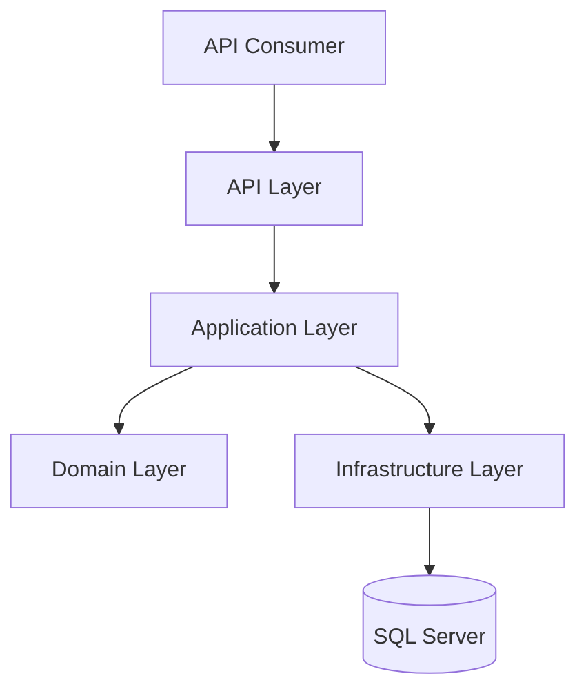

# Architecture

**Status:** Draft v0.1  
**Last Updated:** 2026-10-18  
**Document Path:** `docs/architecture/architecture.md`

## 1. Purpose

This document describes the proposed internal architecture of the Wallet API MVP, including its logical components, layer responsibilities, dependency rules, and request-processing flow.

The architecture prioritizes explicit business rules, reliable financial state transitions, testability, and maintainability without introducing infrastructure that is not justified by the project requirements.

## 2. Architectural Style

The proposed architecture is a layered application inspired by Clean Architecture.

The solution is `src/Backend/PS.Wallet/PS.Wallet.slnx` (`.slnx` format). The backend projects are `PS.Wallet.Domain`, `PS.Wallet.Application`, `PS.Wallet.Infrastructure`, and `PS.Wallet.API`, located under `src/Backend/PS.Wallet/`. Automated tests are `PS.Wallet.UnitTests` and `PS.Wallet.IntegrationTests`, located under `tests/`.

The application is organized into four primary projects:

- **Domain** — core business concepts, invariants, and domain rules.
- **Application** — use cases, orchestration, validation coordination, and persistence abstractions.
- **Infrastructure** — database access and implementations of infrastructure-dependent abstractions.
- **API** — HTTP endpoints, authentication integration, request and response contracts, and exception-to-HTTP mapping.

The initial implementation is a modular monolith: one deployable API application backed by one relational database. The MVP does not require microservices, distributed messaging, or separate deployable business components.

This architecture is a proposal until accepted through the project's architecture decision process.

## 3. Logical Architecture

The diagram represents logical responsibilities, not a complete compile-time dependency graph. Infrastructure implements abstractions defined by inner layers, and dependency injection connects implementations at application startup.

## 4. Layer Responsibilities

### 4.1 Domain

The Domain layer contains the business model and rules that should remain independent of HTTP, Entity Framework Core, and SQL Server.

Expected responsibilities include:

- Wallet and money-related invariants.
- Deposit and transfer business concepts.
- Rules for valid amounts and balance limits.
- Rules governing valid financial state transitions.
- Domain-level types where they make invalid states harder to represent.

The Domain layer must not depend on the API, Infrastructure, a web framework, or a database provider.

It must not perform HTTP requests, read environment variables, or directly persist data.

Implementation details such as the exact aggregate boundaries and whether particular rules are expressed through entities, value objects, or domain services will be finalized in the data-model and ADR documents.

### 4.2 Application

The Application layer coordinates use cases and defines the operations the system supports.

Expected use cases include:

- Retrieve the current user's wallet.
- Create a deposit.
- Create a transfer.
- Retrieve a transfer visible to the current user.
- Retrieve a paginated transaction history.

Responsibilities include:

- Coordinating domain operations.
- Applying use-case-level validation and authorization checks.
- Defining persistence and other required interfaces.
- Coordinating atomic operations and idempotency through explicit abstractions.
- Producing application results that the API can translate into HTTP responses.

Application code must not depend on ASP.NET Core controllers or directly construct SQL queries through a database provider.

The Application layer should not duplicate domain invariants merely to provide a second, potentially inconsistent implementation. Input validation and domain validation serve different purposes and should have clearly defined responsibilities.

### 4.3 Infrastructure

The Infrastructure layer provides implementations for external technical dependencies.

Expected responsibilities include:

- Entity Framework Core database access.
- SQL Server-specific persistence behavior.
- Database transaction coordination where required by the chosen abstraction.
- Persistence implementations for wallets, transfers, deposits, ledger entries, and idempotency records.
- Database-specific concurrency control.
- Database configuration and migration integration.

Infrastructure may depend on Application abstractions and the Domain model. Domain and Application must not depend on Infrastructure implementations.

Database constraints and transaction semantics are part of the correctness model, not merely implementation details. Application-level checks must not be treated as a replacement for necessary database-level protections.

### 4.4 API

The API layer is the external HTTP boundary.

Responsibilities include:

- Defining versioned routes and HTTP methods.
- Binding and validating request data.
- Resolving the authenticated user's identity.
- Invoking Application use cases.
- Mapping application outcomes and known failures to documented HTTP status codes.
- Returning consistent response representations, including Problem Details for errors.
- Applying cross-cutting HTTP concerns such as authentication and request-level middleware.

Controllers should remain thin. They must not contain financial calculations, multi-step database operations, or independent implementations of domain rules.

The API must not expose internal entity or persistence models as public contracts by default.

## 5. Dependency Rules

The following rules are proposed:

1. Domain has no dependency on the other application layers.
2. Application may depend on Domain and its own abstractions.
3. Infrastructure implements abstractions required by Application and uses Domain types as needed.
4. API invokes Application use cases and configures the application composition root.
5. Domain and Application must not depend on ASP.NET Core, EF Core, or SQL Server-specific types.
6. Dependencies between projects must be explicit and must not form circular references.
7. Infrastructure implementations are registered through dependency injection rather than instantiated directly by business use cases.
8. Shared code must not become an unrestricted dependency that bypasses layer boundaries.

The exact project references and allowed package dependencies should be enforced through project structure, code review, and automated checks where appropriate.

## 6. Request Processing

A typical write request follows this logical sequence:

1. The API receives the request.
2. Authentication middleware establishes the request identity.
3. The API binds the request and performs basic contract validation.
4. The Application use case receives the validated input and authenticated actor identity.
5. The use case coordinates business-rule evaluation and persistence operations.
6. Infrastructure executes the required database operations with appropriate transaction and concurrency protections.
7. The use case returns a result describing success or a known failure.
8. The API maps the result to the documented HTTP response.

For a successful deposit or transfer, the financial changes and successful idempotency result must be committed atomically. The exact transaction boundary must be explicit in the implementation and tested against SQL Server.

This sequence is conceptual. The final implementation may introduce additional components for validation, authorization, logging, or transaction handling without changing the responsibility boundaries.

The API uses MediatR for command and query dispatch. `ICurrentUser` is resolved from the authenticated principal and injected into application handlers. The API layer maps application exceptions (`NotFoundException`, domain exceptions) to `ProblemDetails`.

## 7. Financial Operation Boundaries

Financial writes require stricter guarantees than ordinary CRUD operations.

A successful deposit must persist its deposit record, balance change, ledger entry, and idempotency result as one atomic unit.

A successful transfer must persist its transfer record, sender debit, recipient credit, both ledger entries, and idempotency result as one atomic unit.

If an operation fails before commit, it must not leave a partially applied financial change. A database commit must not be followed by a response that falsely implies the operation was rolled back merely because response delivery failed.

Retries after uncertain response delivery must be safe through the idempotency contract.

These guarantees are architectural requirements. Their concrete implementation belongs in the persistence, concurrency, and idempotency designs.

## 8. Validation and Error Handling

Validation is divided by responsibility:

- **API contract validation:** checks whether the request can be parsed and conforms to the external contract.
- **Application validation:** checks use-case prerequisites and coordinates authorization and business preconditions.
- **Domain validation:** enforces business invariants on valid state transitions.
- **Database enforcement:** protects integrity constraints that must remain valid under concurrent access or unexpected application behavior.

Errors must be translated into stable application results and then into the documented HTTP error model.

Infrastructure exceptions must not be exposed directly to clients. Unexpected exceptions should produce a safe generic response while retaining appropriate diagnostic details in server-side logs.

## 9. Authentication and Authorization

Authentication establishes the identity of the caller. Authorization determines which operations and resources that identity may access.

The API layer integrates with the authentication mechanism, while Application use cases receive an explicit actor identity and enforce the relevant use-case permissions.

At minimum:

- A user may access their own wallet balance and history only.
- A transfer sender is derived from the authenticated actor, not from a client-selected sender ID.
- Transfer details are accessible only to the sender or recipient.
- Development-only authentication must not be usable in Production.

The detailed authentication mechanism, credential handling, and threat mitigations are defined in the security documents.

## 10. Persistence and Transaction Management

SQL Server is the planned persistence platform, with Entity Framework Core as the proposed data-access technology.

Transaction management must be designed around the complete financial operation, not around individual repository method calls.

The implementation must make it possible to reason about:

- Which changes belong to a single atomic operation.
- When the transaction begins and commits.
- How concurrent updates are protected.
- How unique idempotency constraints are handled.
- How failures and retries affect persisted state.

Repository abstractions should be introduced where they provide a meaningful application boundary or test seam. They should not be added mechanically for every table if doing so obscures transaction ownership or complicates query behavior.

## 11. Testing Strategy

The architecture must support testing at multiple levels:

- **Domain unit tests:** business invariants and valid or invalid state transitions.
- **Application tests:** use-case orchestration and mapping of expected outcomes.
- **API tests:** routes, authentication, request validation, response contracts, and error behavior.
- **SQL Server integration tests:** real persistence behavior, transaction atomicity, uniqueness constraints, and concurrency scenarios.

Mocks may be used for isolated unit tests, but mocks and in-memory substitutes are insufficient to establish SQL Server transaction and locking correctness.

At least the critical concurrent-transfer and duplicate-idempotency scenarios must be exercised against an actual SQL Server-compatible test environment.

## 12. Proposed Technology Stack

| Concern | Proposed technology |
|---|---|
| Runtime | .NET 10 LTS |
| HTTP API | ASP.NET Core Web API with Controllers |
| Persistence | Entity Framework Core |
| Database | SQL Server |
| Unit and integration testing | xUnit |
| Test doubles | NSubstitute, where appropriate |
| Error response format | Problem Details |
| API versioning | Versioned route prefix, `/api/v1` |

The stack is proposed rather than finalized. Additional libraries, including mediator or validation frameworks, should be introduced only when their benefits justify their complexity and maintenance cost.

## 13. Explicit Non-Goals

The MVP architecture does not require:

- Microservices or distributed transactions.
- Event sourcing as the primary persistence model.
- CQRS infrastructure with separate read and write stores.
- A message broker or asynchronous financial processing pipeline.
- Generic repository and unit-of-work abstractions that duplicate EF Core without a clear benefit.
- A production deployment platform or availability guarantee not otherwise specified.

These exclusions are scope decisions for the MVP, not claims that the approaches are universally unsuitable.

## 14. Open Architectural Decisions

The following decisions require explicit confirmation or separate documentation:

- Exact Domain aggregate boundaries and value-object design. (unique to this document)
- Final persistence interfaces and transaction ownership. (tracked in concurrency.md §14)
- The concrete SQL Server concurrency strategy. (tracked in OQ-006)
- The idempotency record schema, retention policy, and replay representation. (schema and replay tracked in ADR-005 §17 and OQ-010; retention in OQ-010)
- The authentication mechanism and development-authentication safeguards. (resolved in ADR-007)
- Whether a mediator or validation framework is justified. (unique to this document)
- The precise approach to architectural dependency checks. (unique to this document)

Until these decisions are accepted, implementation details must not be treated as fixed solely because they appear in this proposal.

## 15. Related Documents

- `docs/architecture/system-context.md`
- `docs/architecture/data-model.md`
- `docs/architecture/concurrency.md`
- `docs/requirements/domain-rules.md`
- `docs/security/security-model.md`
- `docs/security/threat-model.md`
- `docs/api/api-guidelines.md`
- `docs/api/error-model.md`
- `docs/development/testing.md`
- `docs/adr/ADR-001-architecture-style.md`
- `docs/adr/ADR-003-transaction-atomicity.md`
- `docs/adr/ADR-004-concurrency-control.md`
- `docs/adr/ADR-005-idempotency.md`
