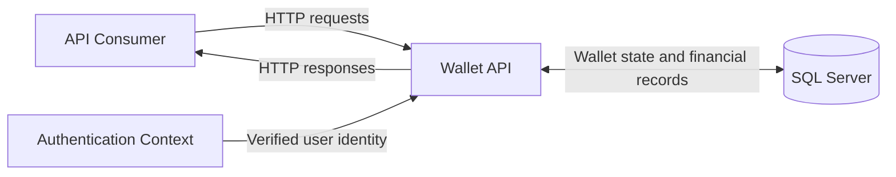

# System Context

**Status:** Draft v0.1  
**Last Updated:** 2026-10-18  
**Document Path:** `docs/architecture/system-context.md`

## 1. Purpose

This document defines the system boundary of the Wallet API MVP, its primary actors, external dependencies, and high-level interactions.

It describes the system from a context perspective. Internal application layers, database schema, endpoint contracts, and implementation-specific concurrency mechanisms are documented separately.

## 2. System Overview

The Wallet API is a backend service that exposes authenticated operations for managing virtual USD wallet balances and transaction history.

The system supports virtual deposits and transfers between users within the application. It does not move real money and does not integrate with banks, card networks, payment processors, or external financial institutions.

The API is designed to demonstrate reliable handling of financial state, including transactional consistency, money precision, idempotency, and concurrent requests.

The MVP uses a relational database to persist wallet state and financial records. SQL Server is the planned database platform.

## 3. System Boundary

### 3.1 Inside the System

The Wallet API is responsible for:

- Identifying the authenticated user for each protected operation.
- Providing access to the user's wallet balance.
- Accepting and validating virtual deposit requests.
- Accepting and validating transfers between application users.
- Enforcing wallet and transaction business rules.
- Persisting wallet balances and financial records consistently.
- Recording deposits, transfers, and corresponding ledger entries.
- Preventing duplicate financial effects when an idempotent request is replayed.
- Providing the user's transaction history with bounded pagination.
- Returning documented success and error responses.
- Producing diagnostic information needed for development and troubleshooting.

### 3.2 Outside the System

The following are outside the Wallet API's responsibility in the MVP:

- Real-money movement and payment settlement.
- Bank accounts, payment cards, and external payment providers.
- Currency conversion and multi-currency accounting.
- User registration, password recovery, and full identity lifecycle management.
- External identity-provider administration, unless introduced by a later architectural decision.
- Frontend rendering and client-side state management.
- Production infrastructure provisioning and operational service-level guarantees.

These exclusions do not prevent future extensions; they define the current MVP boundary.

## 4. Actors

### 4.1 API Consumer

An API consumer is a client that sends HTTP requests to the Wallet API.

The consumer may be an API testing tool, a development client, or a future frontend application. The MVP does not require a frontend to be implemented before the backend can be tested.

The API consumer is responsible for sending requests that conform to the API contract and supplying an idempotency key for operations that require one. The server remains responsible for validating all input and enforcing authorization and business rules.

### 4.2 Authenticated User

An authenticated user can access wallet operations permitted to that identity.

The server derives the acting user's identity from the authenticated request context. A client must not be able to select another user as the transfer sender by supplying an arbitrary sender identifier.

A user may view their own wallet balance and history. A transfer's details may be exposed only to its sender or recipient, subject to the API contract.

### 4.3 Development Identity

The development environment includes predefined users, such as Alice and Bob, to support repeatable manual testing and automated scenarios.

Any development-only authentication mechanism must be disabled in the Production environment. The exact mechanism and its safeguards are defined in the security documentation.

## 5. External Dependencies

### 5.1 SQL Server

SQL Server is the planned relational persistence dependency.

The database stores the data required to maintain wallet state and financial history, including:

- Users and wallet ownership references.
- Current wallet balances.
- Deposit and transfer records.
- Append-only ledger entries.
- Idempotency records and the information needed to replay successful responses.

Financially related changes that form one successful operation must be persisted atomically. Detailed transaction boundaries and concurrency controls are specified in the architecture and database documentation.

### 5.2 Authentication Context

Protected API operations depend on a server-verifiable authentication context.

The context must provide a trustworthy user identity. Development authentication is a separate concern from the business logic and must not provide a usable authentication bypass in Production.

The final authentication implementation remains subject to the security design.

### 5.3 Observability Infrastructure

The application will expose diagnostic logs and relevant operational signals through the application's logging and observability mechanisms.

A separate logging platform, monitoring service, or distributed tracing backend is not assumed to be required for the MVP.

Sensitive information, credentials, and unnecessary financial data must not be written to logs.

## 6. High-Level Interactions

### 6.1 Read Wallet Balance

1. The API consumer sends a request to retrieve the current user's wallet.
2. The API authenticates the request and resolves the current user.
3. The application retrieves the corresponding wallet state.
4. The API returns the balance and documented wallet information.

The consumer cannot choose an arbitrary wallet owner through an untrusted request parameter.

### 6.2 Create a Deposit

1. The API consumer submits a virtual deposit request with an idempotency key.
2. The API validates authentication, request structure, amount precision, and business limits.
3. The application records the deposit, updates the wallet balance, creates the corresponding ledger entry, and persists the successful idempotency result as one atomic operation.
4. The API returns the documented successful response.

A replay of the same key and equivalent request must not create another deposit.

### 6.3 Create a Transfer

1. The API consumer submits a recipient username, an amount, and an idempotency key.
2. The API authenticates the sender and validates the request.
3. The application resolves the recipient and verifies the applicable business rules.
4. The application debits the sender, credits the recipient, records the transfer, creates both corresponding ledger entries, and persists the successful idempotency result atomically.
5. The API returns the documented successful response.

If a required condition fails, the transfer must not leave a partial financial change. Concurrent requests must not violate wallet invariants.

### 6.4 Read Transaction History

1. The API consumer requests the current user's transaction history, optionally supplying cursor pagination parameters.
2. The API authenticates the request and resolves the current user.
3. The application retrieves the relevant ledger-backed transaction history in the agreed order.
4. The API returns a bounded page of results and, when applicable, a cursor for continuing pagination.

History access must be restricted to the current user's own wallet.

## 7. Context Diagram

The diagram shows logical dependencies rather than deployment topology. Authentication may be implemented within the API host or through a separate component; that implementation decision is not fixed by this context diagram.

## 8. Trust Boundaries

The system must treat the following boundaries explicitly:

- **Client to API:** all client input is untrusted and must be validated.
- **Authentication to application logic:** the acting user's identity must come from a verified authentication context.
- **Application to database:** persistence operations must preserve data integrity, transactional atomicity, and access constraints.
- **Development to Production:** development-only authentication and test conveniences must not become Production access paths.

The API must not rely on frontend validation, client-supplied ownership claims, or request ordering to enforce financial invariants.

## 9. Assumptions and Constraints

- The MVP operates with virtual USD balances only.
- Each user owns exactly one wallet.
- Wallet balances and financial records are persisted in SQL Server.
- A successful deposit or transfer is processed synchronously.
- The system does not expose artificial pending states for these operations.
- Alice and Bob are predefined development identities; their existence does not imply an implemented registration workflow.
- A frontend may be developed later and is not a prerequisite for backend functionality.
- Production deployment topology, hosting model, and external authentication provider are not defined by this document.

## 10. Related Documents

- `docs/requirements/overview.md`
- `docs/requirements/functional-requirements.md`
- `docs/requirements/non-functional-requirements.md`
- `docs/requirements/domain-rules.md`
- `docs/architecture/architecture.md`
- `docs/architecture/data-model.md`
- `docs/architecture/concurrency.md`
- `docs/security/security-model.md`
- `docs/api/endpoints.md`
- `docs/operations/observability.md`

